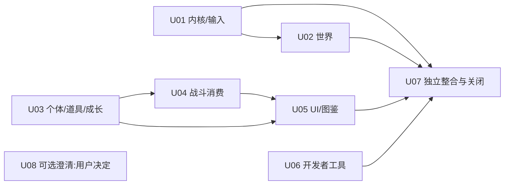

# 第三轮全局独立评审总报告

**有限静态评审与集成已完成；当前规格仍有23项必修缺口，不能宣称完整内容、全部可得参数、实际启用或游戏运行通过。** 25保留ID为19项P2、6项P3；其中23 REQUIRED_REVISION、1 OPTIONAL、1 NO_REQUIRED_REVISION。未更新正式规格、参考、公共登记或历史裁决。未来update未启动。

本轮：第一轮本地WP review/update；第二轮全局review及B01–B21整改/229关闭/FINAL1–2；第三轮本次本地review，后接用户日后另行指示的云端update。今天只有review与成果发布。

固定交付commit `86b4d7e1d8645e75af91a215240f8786a5bb4ca8`/tree `42c29efb5422772a1d90f657f25983600f500f28`。受审正式actual `167296dbe9e2384627b0ed696e87aeb01f211252`/tree `33598d8a2a3acdd093cc4fe23f48eea8666100f3`：131逐文件工作字节/blob/SHA256/bytes一致；交付整仓tree因报告导航不同，不要求等于actual。参考 `8c5911e4a4b07b07e832e4bb0d5d8859e88b4a9b`/tree `7589c800b61ba13a13040ed0d686979b80a84fd0`，432工作字节身份一致/无tracked dirty。必要151/13/14/2/控制与覆盖逐字节匹配，旧62候选完整保全。详baseline/protected-input-check。

独立review实际任务、入口、角色和模型请求见[progress.json](progress.json)与[module-results.json](module-results.json)。主review /root独立于formal作者/登记，M02/M04/M05及跨模块亲审；其余为fresh可见subagent。gpt-6.1-sol/ultra/Standard(default)请求被接纳，回显UNVERIFIED；root回显同样未验证，无Fast/隐蔽CLI模型。平台实际4并发槽含主角色，分批公开派发；没有伪造Desktop独立链接，真实父会话入口 codex://threads/01a12bbf-9300-7833-82d7-d392ae9fa731。旧任务未恢复，停止回执完整复制静态审计/原件不变。

独立能力分母从参考域入口、调用者、数据、配置、UI与工具发现，757分域行为族含共享投影：601 SUPPORTED_STATIC、139 PARTIAL、7 UNRESOLVED、9 MISSING_MATERIAL、1 NOT_REVIEWED。不是互斥Feature数、旧113、方法名或源文件数。432文件均分类归属，131正式均逆向归属，15856条导航记录保实际状态；条数不签语义。核心行为/数学/正常失败边界有审读范围，可供实现/测试设计；所有有效完整性/未读条件仍限定。

| 模块 | 有限行为族 | 当前范围/产物 |
| --- | ---: | --- |
| M01 | 39 | [M01报告](M01/report.md)；source/spec/测试范围和限制见对应七产物 |
| M02 | 40 | [M02报告](M02/report.md)；source/spec/测试范围和限制见对应七产物 |
| M03 | 47 | [M03报告](M03/report.md)；source/spec/测试范围和限制见对应七产物 |
| M04 | 36 | [M04报告](M04/report.md)；source/spec/测试范围和限制见对应七产物 |
| M05 | 46 | [M05报告](M05/report.md)；source/spec/测试范围和限制见对应七产物 |
| M06 | 54 | [M06报告](M06/report.md)；source/spec/测试范围和限制见对应七产物 |
| M07 | 75 | [M07报告](M07/report.md)；source/spec/测试范围和限制见对应七产物 |
| M08 | 67 | [M08报告](M08/report.md)；source/spec/测试范围和限制见对应七产物 |
| M09 | 114 | [M09报告](M09/report.md)；source/spec/测试范围和限制见对应七产物 |
| M10 | 42 | [M10报告](M10/report.md)；source/spec/测试范围和限制见对应七产物 |
| M11 | 87 | [M11报告](M11/report.md)；source/spec/测试范围和限制见对应七产物 |
| M12 | 110 | [M12报告](M12/report.md)；source/spec/测试范围和限制见对应七产物 |

完整差异如下；每项精确source/spec身份、前提、最小反例、影响、风险、关联/异议、建议及可验证结束条件见[findings.json](findings.json)。

| ID | 严重性 | 处置 | 具体问题 |
| --- | --- | --- | --- |
| GR3-M01-001 | P2 | REQUIRED_REVISION | 翻译文本导入的空白、行首注释和修剪规则未进入往返合同 |
| GR3-M01-002 | P2 | REQUIRED_REVISION | 合并地图文本导出可因较早空桶跳过所有较晚有效文本 |
| GR3-M01-003 | P2 | REQUIRED_REVISION | PBS 值在 schema 转换前删去井号后缀，q 原样合同未限定输入层 |
| GR3-M01-004 | P2 | REQUIRED_REVISION | 电话默认消息的重复节会后项覆盖，不遵守通用重复拒绝结论 |
| GR3-M02-001 | P2 | REQUIRED_REVISION | 通知回调抛错后的停止和部分状态未进入扩展合同 |
| GR3-M02-002 | P2 | REQUIRED_REVISION | 持久值重复身份的保存、读取和撤销语义缺失 |
| GR3-M02-003 | P3 | NO_REQUIRED_REVISION | 无旧存档紧急保存的备份提示未与实际备份状态分开 |
| GR3-M03-001 | P2 | REQUIRED_REVISION | 地图镜头卷动的速度、钳边与脚本等待能力没有形成独立合同 |
| GR3-M03-002 | P2 | REQUIRED_REVISION | 地牢建立通知也可由未驻留地图查询触发，边缘不重生成的陈述缺少前提 |
| GR3-M03-003 | P2 | REQUIRED_REVISION | SPECIAL触发的具名过场跳过与事件重新启动能力未承接 |
| GR3-M03-004 | P2 | REQUIRED_REVISION | 地图事件变更记录的读档清空及条件恢复副作用未形成合同 |
| GR3-M04-001 | P2 | REQUIRED_REVISION | 个体编号斑点图像修饰缺少可得的数学与默认形状合同 |
| GR3-M05-001 | P3 | REQUIRED_REVISION | 可得个体尺寸辅助缺少独立毫米数学合同 |
| GR3-M05-002 | P2 | REQUIRED_REVISION | 探测仪只列功能名，缺少搜索、方向与响应合同 |
| GR3-M06-001 | P3 | REQUIRED_REVISION | 经验设置辅助遗漏同级变化的差量消息及先提示后写入的时点 |
| GR3-M07-001 | P2 | REQUIRED_REVISION | 执行期退款未清消费身份，同轮正常终局可再次退款；交界缺少确定库存结果 |
| GR3-M08-001 | P2 | REQUIRED_REVISION | 自然之恩续击在首击自耗树果后缺少空持物查询失败合同 |
| GR3-M09-001 | P3 | OPTIONAL | WP51下游定位将录像主责任误指WP57 |
| GR3-M10-001 | P2 | REQUIRED_REVISION | 持物移位经Box Link取回来源物品后仍提交旧物品，重复计数未进入合同 |
| GR3-M10-002 | P3 | REQUIRED_REVISION | 共享数量选择与两种商店的同轮输入优先序不同，统一语义漏掉确定出口 |
| GR3-M10-003 | P2 | REQUIRED_REVISION | 战斗确认与命令列表逐字中按键仅恢复，正文却写快进 |
| GR3-M10-004 | P2 | REQUIRED_REVISION | Arena UI覆写表仍称更替展示与每三回合判决，与已修正领域合同冲突 |
| GR3-M11-001 | P2 | REQUIRED_REVISION | 图鉴栖息地多格掩码及同格可见点并集仍无可计算合同 |
| GR3-M12-001 | P3 | REQUIRED_REVISION | 区域地图工具标记图被错误列为缺失 |
| GR3-M12-002 | P2 | REQUIRED_REVISION | 设施队伍结算把应累计的已结算场次误写为清空后的历史长度 |

优先顺序：先明确输入格式/通知异常/持久身份与世界恢复的合同，再处理消费/部分提交及每击失败链，之后补UI/图鉴消费者、数学/工具小缺口。可按[proposed-batches.json](proposed-batches.json)六个主题批并行与依赖整合；U07统一整合，U08仅用户选择的可选范围。所有23必修各有唯一主题批，跨批共享文件唯一写者及顺序交接见[shared-file-owners.json](shared-file-owners.json)。补当前事实不代表未来必须永远复刻旧bug，兼容政策由用户决定。

229旧必修控制全部按有效qualified scope、原/批准对象、相应FINAL、当前模块投影映射；初始无模块分配的统计C01由独立integration补有界实际统计。341贡献逐exact五元组/local scope，不推整ID或新签名；21/21接受/229 CLOSED/0 OPEN仍是历史约定范围，未无证据改写或重新执行。旧A019/B030/D012/D017非必修保原裁决。[regression-229.tsv](regression-229.tsv)、[accepted-341-scope.json](accepted-341-scope.json)和完整integration附件可定位全部记录/关联。

54既有交界/8链及18新增链由独立主角色和integration reviewer实质归并，[junction-review.md](junction-review.md)给具体正常/失败/边界，JSON保完整前提和局部未知。M02-003保原提交与M10反证/root NoRequired；旧A022/A059错误邻接片段剔除复用、G2-5/G6-5导航纠正，其余历史记录完整保留，未转移旧验收签名。

可得但未全审：PBS/翻译语料/完整物种与设施名单组合；部分Transitions逐像素body/错误修复输出/具体消费者；完整皮肤字体长词矩阵/摘要坐标/球粒子参数与反馈显示；归档/字体/音色/exe/DLL内容；跨世代和动态插件/实际编译启用。这些不全是缺资源，逐能力记录见[limits-and-missing-materials.md](limits-and-missing-materials.md)及[范围审计](delivery-scope-audit/scope-audit.md)。未知不等于无问题，也不等于已支持。

真实缺项为Graphics/Audio/Plugins/Game.ini/Game.rxproj、MapInfos/地图、System/Tilesets/CommonEvents/动画数据库等。knownpoint.bmp/selpoint.bmp实际可得；头部/身份并不证明工具渲染。真实地图/Demo接待/授予/收费奖励/解锁/录制回放、宿主时序/字体/输入/音频与异常效果均未证。运行观察、参考/行为/静态案例执行、真实Demo链均0；Git/hash/JSON/PBS字段/BMP头检查不当运行证明。

净室质量：本轮按外部身份/顺序/数学/状态/异常/取消描述，源路径和函数身份只取证定位；不把源容器/类/继承强制成TypeScript API、RPG Maker模板或生产实现。新必修建议仍为文档/表/向量，并非实际修复。

完整云端接手文件： [cloud-third-update-handoff-prompt.md](cloud-third-update-handoff-prompt.md) 与 [cloud-third-update-handoff-manifest.json](cloud-third-update-handoff-manifest.json)。完整提示词在所有实质review完成后生成，不预写PASS。成果独立review分支已授权发布；本次冻结时尚未提交/推送，实际精确发布/读回状态随后记publication receipts与本报告发布附记，不能把本地路径当云端可达。报告发布不授权今天update，不合并main。

此图只表示未来建议批次的文档依赖，未创建或启动update任务。
